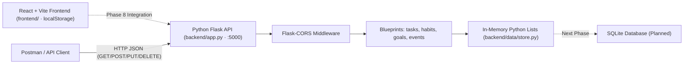
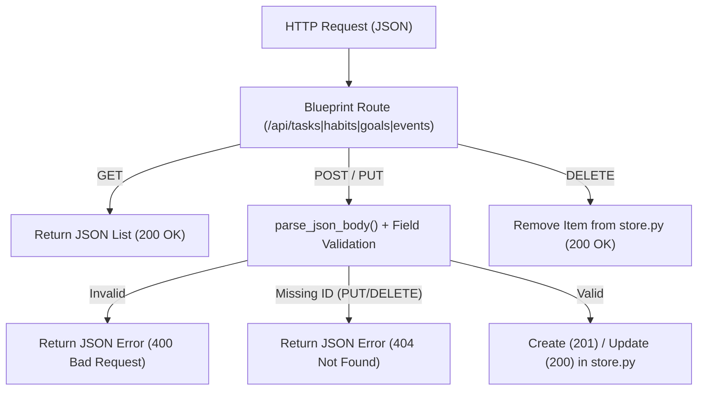

# LifeSync – Personal Life Management Dashboard Documentation

## Overview
**LifeSync** is a full-stack personal productivity dashboard designed to help users manage daily tasks, personal goals, habits, calendar scheduling, activities, and progress reports.

This document reflects:
- **Frontend (`frontend/`)**: React.js (JavaScript) + Vite + `lucide-react` + `recharts` using browser `localStorage` (unmodified in Phase 7).
- **Backend (`backend/`)**: **Phase 7 Python Flask REST API** with **Flask-CORS**, modular Blueprint routes, JSON validation, and temporary Python in-memory lists (`SQLite` persistence and frontend API integration will follow in later phases).

---

## Recent Changes (Phase 7: Python Flask Backend API)

### 1. Backend Folder Structure
```text
LifeSync/
├── frontend/                  # Existing React + Vite frontend (unchanged)
├── backend/
│   ├── venv/                  # Python 3.13 virtual environment (Flask 3.1.3, flask-cors 6.0.5)
│   ├── requirements.txt       # Pinned Python backend dependencies
│   ├── app.py                 # Flask app factory, CORS, /api/health, Blueprint registration, JSON error handlers
│   ├── data/
│   │   └── store.py           # Temporary in-memory lists (tasks_store, habits_store, goals_store, events_store)
│   └── routes/
│       ├── __init__.py        # Routes package marker
│       ├── validation.py      # Shared JSON parsing, ID generation, lookup, date/time validation
│       ├── tasks.py           # /api/tasks Blueprint (GET, POST, PUT, DELETE)
│       ├── habits.py          # /api/habits Blueprint (GET, POST, PUT, DELETE)
│       ├── goals.py           # /api/goals Blueprint (GET, POST, PUT, DELETE + auto status)
│       └── events.py          # /api/events Blueprint (GET, POST, PUT, DELETE)
└── personname.md              # System documentation
```

---

## Backend Logic Descriptions

1. **Application Entry & CORS (`backend/app.py`)**:
   - `create_app()` initializes Flask, enables `CORS(app)` so the React app (`http://localhost:5173`) can make cross-origin requests to port `5000`, registers the 4 Blueprints, exposes `GET /api/health`, and returns JSON for HTTP `400`, `404`, `405`, and `500` errors.
2. **In-Memory Data Store (`backend/data/store.py`)**:
   - Stores temporary Python lists (`tasks_store`, `habits_store`, `goals_store`, `events_store`) pre-seeded with realistic sample dictionaries matching the frontend field names.
3. **Validation & Helper Layer (`backend/routes/validation.py`)**:
   - `parse_json_body()` ensures incoming requests carry a valid JSON object (`400` otherwise).
   - `is_valid_date_string()` and `is_valid_time_string()` enforce `YYYY-MM-DD` and `HH:MM` formats.
   - `get_next_id()` computes sequential integer IDs safely even after deletions.
4. **Blueprint Route Modules (`backend/routes/*.py`)**:
   - Each module isolates its resource endpoints (`GET`, `POST`, `PUT`, `DELETE`) and returns `200`, `201`, `400`, or `404` JSON responses.
   - `routes/goals.py` automatically computes goal `status` (`Completed`, `Overdue`, `Not Started`, `In Progress`) from `progress` (`0–100`) and `targetDate`.

---

## Architecture & Request Flow Diagrams

### Full-Stack Architecture (Phase 7 State)


### API Request Lifecycle


---

## REST API Contracts (`http://localhost:5000`)

### Health Check
- `GET /api/health` → `200 OK`: `{"status": "ok", "message": "LifeSync Flask API is running", "storage": "in-memory"}`

### Tasks (`/api/tasks`)
- `GET /api/tasks` → `200 OK`: `{"tasks": [...], "count": N}`
- `POST /api/tasks` → `201 Created`: Body `{"title" (required), "description", "priority" (High|Medium|Low), "dueDate" (YYYY-MM-DD), "category" (Study|Personal|Work), "completed" (bool)}`
- `PUT /api/tasks/<id>` → `200 OK` / `404 Not Found`
- `DELETE /api/tasks/<id>` → `200 OK` / `404 Not Found`

### Habits (`/api/habits`)
- `GET /api/habits` → `200 OK`: `{"habits": [...], "count": N}`
- `POST /api/habits` → `201 Created`: Body `{"name" (required), "description", "category" (Health|Learning|Mindfulness|Productivity|Personal), "completedDates" (string[]), "streakDays" (int), "completed" (bool)}`
- `PUT /api/habits/<id>` → `200 OK` / `404 Not Found`
- `DELETE /api/habits/<id>` → `200 OK` / `404 Not Found`

### Goals (`/api/goals`)
- `GET /api/goals` → `200 OK`: `{"goals": [...], "count": N}`
- `POST /api/goals` → `201 Created`: Body `{"title" (required), "description", "category" (Personal|Education|Career|Health|Fitness|Finance|Other), "startDate", "targetDate", "progress" (0-100)}` (auto-calculates `status`)
- `PUT /api/goals/<id>` → `200 OK` / `404 Not Found`
- `DELETE /api/goals/<id>` → `200 OK` / `404 Not Found`

### Calendar Events (`/api/events`)
- `GET /api/events` → `200 OK`: `{"events": [...], "count": N}`
- `POST /api/events` → `201 Created`: Body `{"title" (required), "description", "date" (required YYYY-MM-DD), "startTime" (HH:MM), "endTime" (HH:MM), "category" (Personal|Work|Education|Meeting|Other), "priority" (High|Medium|Low)}`
- `PUT /api/events/<id>` → `200 OK` / `404 Not Found`
- `DELETE /api/events/<id>` → `200 OK` / `404 Not Found`
