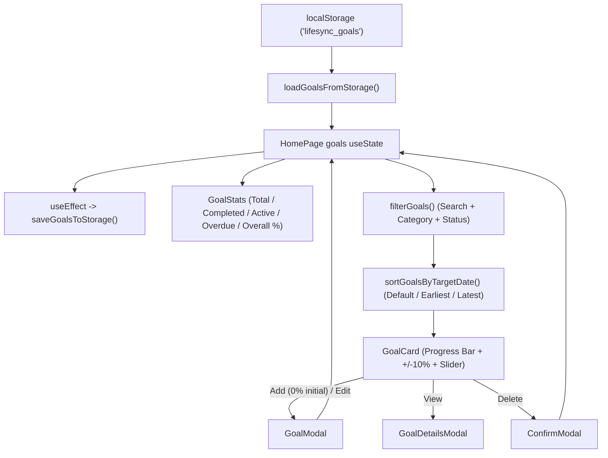
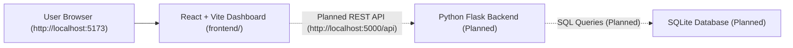

# LifeSync – Personal Life Management Dashboard Documentation

## Overview
**LifeSync** is a full-stack personal productivity dashboard designed to help users manage daily tasks, personal goals, habits, activities, and progress reports.

This document reflects the complete **Frontend Application** (Dashboard, Task Manager, Habit Tracker, **Phase 5 Goal Management**, Activities, and Progress Reports) built with **React.js (JavaScript)**, **Vite**, **`lucide-react`**, and **`recharts`**, using browser `localStorage` for persistence. The **Python Flask** backend and **SQLite** database will be added and documented in a future phase.

---

## Recent Changes (Phase 5: Goal Management Functionality)

### 1. Goal Management Capabilities
- **Add Goal (`GoalModal.jsx`)**: New goals start automatically at `0%` progress (`Not Started`) with Goal Title, Description, Category (`Personal`, `Education`, `Career`, `Health`, `Fitness`, `Finance`, `Other`), Start Date, and Target Completion Date.
- **Edit Goal (`GoalModal.jsx`)**: Pre-fills all goal details and enables progress adjustment (`0–100%`).
- **Delete Goal (`ConfirmModal.jsx`)**: Reuses `ConfirmModal` for deletion confirmation before removing a goal and logging a deletion activity.
- **Goal Progress & Automatic Status (`goalUtils.js`, `GoalCard.jsx`)**:
  - Progress bars with `-10%` / `+10%` buttons and a `0–100%` slider.
  - Status automatically updates to:
    - `'Completed'` when `progress === 100`
    - `'Overdue'` when `progress < 100` and `targetDate < today`
    - `'Not Started'` when `progress === 0` (and not overdue)
    - `'In Progress'` when `0 < progress < 100` (and not overdue)
- **Dashboard Statistics (`GoalStats.jsx`)**: Displays **Total goals**, **Completed goals**, **Active goals**, **Overdue goals**, and **Overall progress (%)**.
- **Filter & Sort (`GoalsSection.jsx`, `goalUtils.js`)**:
  - Search by title
  - Filter by Category (`Personal`, `Education`, `Career`, `Health`, `Fitness`, `Finance`, `Other`)
  - Filter by Status (`All`, `Not Started`, `In Progress`, `Completed`, `Overdue`)
  - Sort by Target Date (`Default`, `Target date: Earliest`, `Target date: Latest`)
- **Persistence**: Automatically reads and writes `'lifesync_goals'` in browser `localStorage` via `useState` + `useEffect` in `HomePage.jsx` (legacy `'Study'` category migrates cleanly to `'Education'`).

---

## Logic & Flow Diagram

### Phase 5 Goal Management Flow

### Planned Full-Stack Architecture

---

## Client-Side Goal Schema (`localStorage` key: `lifesync_goals`)

| Field | Type | Required | Description |
| :--- | :--- | :--- | :--- |
| `id` | `number` | Yes | Unique goal identifier |
| `title` | `string` | Yes | Goal title |
| `description` | `string` | No | Optional goal description |
| `category` | `'Personal' \| 'Education' \| 'Career' \| 'Health' \| 'Fitness' \| 'Finance' \| 'Other'` | Yes | Goal category |
| `startDate` | `string` | No | ISO start date (`YYYY-MM-DD`) |
| `targetDate` | `string` | No | ISO target completion date (`YYYY-MM-DD`) |
| `progress` | `number` | Yes | Integer percentage (`0` to `100`, new goals start at `0`) |
| `status` | `'Not Started' \| 'In Progress' \| 'Completed' \| 'Overdue'` | Yes | Derived from `progress` and `targetDate` |

- **Task Schema (`lifesync_tasks`)**, **Habit Schema (`lifesync_habits`)**, and **Activity Schema (`lifesync_activities`)** remain active and live-synced with `ReportsSection.jsx`.
- **Planned Backend API**: `http://localhost:5000/api` (placeholder in `frontend/src/services/api.js`); Python Flask + SQLite persistence will be added in a future phase.
