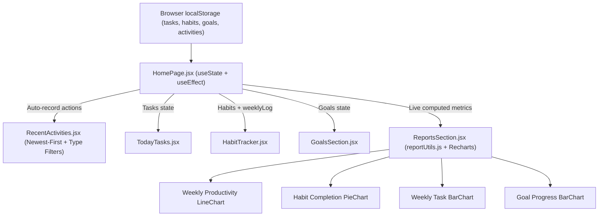
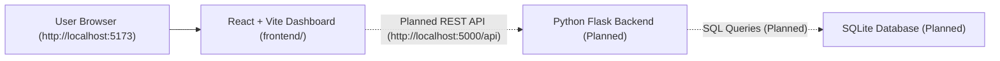

# LifeSync – Personal Life Management Dashboard Documentation

## Overview
**LifeSync** is a full-stack personal productivity dashboard designed to help users manage daily tasks, personal goals, habits, activities, and progress reports.

This document reflects **Phases 1–6** of the frontend built with **React.js (JavaScript)**, **Vite**, **`lucide-react`**, and **`recharts`**, using browser `localStorage` for tasks, habits, goals, and activity history. The **Python Flask** backend and **SQLite** database will be added and documented in a future phase.

---

## Recent Changes (Phase 6: Activities & Progress Reports)

### 1. Project File Structure
```text
LifeSync/
├── frontend/
│   ├── index.html                        # HTML shell loading DM Sans & JetBrains Mono
│   ├── package.json                      # React, Vite, Lucide icons, Recharts, and npm scripts
│   ├── vite.config.js                    # Vite + React plugin configuration
│   └── src/
│       ├── data/
│       │   └── sampleData.js             # Initial tasks, habits (with weeklyLog), goals, activities
│       ├── utils/
│       │   ├── taskUtils.js              # Task localStorage, search, filters, date format
│       │   ├── goalUtils.js              # Goal localStorage, status derivation, deadlines, filters
│       │   ├── habitUtils.js             # Habit localStorage, 7-day weeklyLog, streak updates
│       │   ├── activityUtils.js          # Activity recording, newest-first sorting, filters, localStorage
│       │   └── reportUtils.js            # Dynamic Task/Habit/Goal stats & Recharts series builders
│       ├── components/
│       │   ├── Sidebar.jsx               # Navigation sidebar including Reports tab
│       │   ├── DashboardHeader.jsx       # Active section title, morning context, date, profile
│       │   ├── StatsCards.jsx            # 4 dynamic overview KPI cards
│       │   ├── TodayTasks.jsx            # Task Manager toolbar, list, Add/Edit/Delete modal triggers
│       │   ├── TaskItem.jsx              # Task card
│       │   ├── TaskModal.jsx             # Add/Edit task modal
│       │   ├── ConfirmModal.jsx          # Reusable delete confirmation modal
│       │   ├── GoalsSection.jsx          # Goal Tracker dashboard, deadline alerts, filters, modals
│       │   ├── GoalStats.jsx             # Goal summary cards
│       │   ├── GoalCard.jsx              # Goal card with badges and progress slider
│       │   ├── GoalModal.jsx             # Add/Edit goal modal
│       │   ├── GoalDetailsModal.jsx      # Detailed goal view modal
│       │   ├── HabitTracker.jsx          # Interactive daily habit check-ins with streak persistence
│       │   ├── RecentActivities.jsx      # Filterable activity timeline (All/Tasks/Habits/Goals), newest first
│       │   ├── ReportsSection.jsx        # Task/Habit/Goal stats, streaks, and 4 Recharts charts
│       │   └── SettingsPanel.jsx         # Workspace info
│       ├── pages/
│       │   └── HomePage.jsx              # Central useState + useEffect store & auto-activity recording
│       ├── services/
│       │   └── api.js                    # Placeholder API_BASE_URL for future Flask API
│       ├── styles/
│       │   ├── global.css                # Warm Paper & Cobalt Ink tokens, shell, tasks, modals
│       │   ├── goals.css                 # Goal Tracker styles
│       │   └── reports.css               # Activities filter bar, Progress Reports, and chart layout
│       ├── App.jsx                       # Root layout combining Sidebar, DashboardHeader, HomePage
│       └── main.jsx                      # Mounts <App /> and loads global.css, goals.css, reports.css
└── personname.md                         # System documentation
```

---

## Logic Descriptions

1. **Automatic Activity Recording (`src/utils/activityUtils.js` & `src/pages/HomePage.jsx`)**:
   - `HomePage.jsx` calls `pushActivity(type, title, description)` via `createActivityRecord()` on:
     - **Task creation** (`handleAddTask`)
     - **Task completion** (`handleToggleTask`)
     - **Task deletion** (`handleDeleteTask`)
     - **Habit completion** (`handleToggleHabit`)
     - **Goal creation** (`handleAddGoal`)
     - **Goal progress updates / completion** (`handleEditGoal` & `handleSetGoalProgress`)
   - All activities are sorted newest-first (`sortActivitiesNewestFirst`), persisted in `localStorage` under `'lifesync_activities'` (capped at 100 entries), and displayed with title, description, formatted date & time, and category filter tabs (`All`, `Tasks`, `Habits`, `Goals`) in `RecentActivities.jsx`.

2. **Habit Weekly Tracking & Streaks (`src/utils/habitUtils.js`)**:
   - Habits load from `localStorage` (`'lifesync_habits'`) and save via `useEffect`.
   - Each habit stores a 7-day `weeklyLog` keyed by `YYYY-MM-DD` and a numeric `streakDays`.
   - `toggleHabitCompletion()` updates today's log entry and adjusts `streakDays` dynamically.

3. **Live Progress Reports & Recharts Analytics (`src/utils/reportUtils.js` & `src/components/ReportsSection.jsx`)**:
   - All report numbers and chart series derive directly from live `tasks`, `habits`, `goals`, and `activities` state (zero hardcoded statistics) and handle empty arrays gracefully:
     - **Task Statistics**: Total, completed, pending, completion percentage (`getTaskReportStats`).
     - **Habit Statistics**: Total, completed today, 7-day weekly completion percentage, best streak & per-habit streaks (`getHabitReportStats`).
     - **Goal Statistics**: Total, completed, in-progress, average progress (`getGoalReportStats`).
     - **Recharts Visualizations**:
       1. Weekly Productivity Line Chart (`LineChart` via `getWeeklyProductivityChartData`)
       2. Habit Completion Pie Chart (`PieChart` via `getHabitPieChartData`)
       3. Weekly Task Completion Bar Chart (`BarChart` via `getWeeklyTaskChartData`)
       4. Goal Progress Bar Chart (`BarChart` via `getGoalChartData`)

---

## Architecture & Flow Diagrams

### Phase 6 Data Persistence, Activity Logging & Analytics Flow


### Planned Full-Stack Architecture


---

## Client-Side Schemas & Planned API Contract

### Activity Object Schema (`localStorage` key: `lifesync_activities`)
| Field | Type | Required | Description |
| :--- | :--- | :--- | :--- |
| `id` | `string` | Yes | Unique activity record ID |
| `type` | `'task' \| 'habit' \| 'goal'` | Yes | Source module category |
| `title` | `string` | Yes | Short action headline |
| `description` | `string` | No | Contextual detail of the action |
| `timestamp` | `string` | Yes | ISO 8601 date-time string |

### Habit Object Schema (`localStorage` key: `lifesync_habits`)
| Field | Type | Required | Description |
| :--- | :--- | :--- | :--- |
| `id` | `number` | Yes | Unique habit identifier |
| `name` | `string` | Yes | Habit name |
| `completed` | `boolean` | Yes | Completion state for today |
| `streakDays` | `number` | Yes | Numeric streak length |
| `streak` | `string` | Yes | Formatted streak label |
| `weeklyLog` | `Record<string, boolean>` | Yes | 7-day completion map keyed by `YYYY-MM-DD` |

- **Task Schema (`lifesync_tasks`)**: `id`, `title`, `description`, `priority`, `dueDate`, `category`, `completed`.
- **Goal Schema (`lifesync_goals`)**: `id`, `title`, `description`, `category`, `startDate`, `targetDate`, `progress`, `status`.
- **Planned Backend API**: `http://localhost:5000/api` (placeholder in `frontend/src/services/api.js`); Python Flask + SQLite persistence will replace `localStorage` in a future phase.
