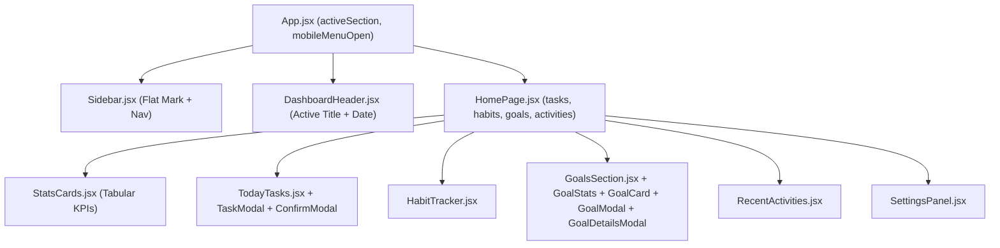
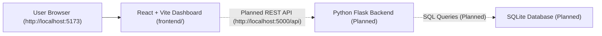

# LifeSync – Personal Life Management Dashboard Documentation

## Overview
**LifeSync** is a full-stack personal productivity dashboard designed to help users manage daily tasks, personal goals, habits, and activities.

This document reflects the **Unslopped Frontend Dashboard + Task Manager + Phase 5 Goal Tracker** built with **React.js (JavaScript)**, **Vite**, and **`lucide-react`**, using browser `localStorage` for task and goal persistence. The **Python Flask** backend and **SQLite** database will be added and documented in a future phase.

---

## Recent Changes (Unslop UI/UX Polish Pass)

### 1. Design Direction & Visual System
- **Direction**: *Warm Paper & Cobalt Ink* — calm, structured, quietly focused planner aesthetic.
- **Neutral Ramp (`src/styles/global.css`)**:
  - Sidebar `#f2eee6`, Page `#f7f4ee`, Cards/Modals `#fdfbf7`, Raised Controls `#efe9df`, Hairline borders `rgba(31, 27, 22, 0.09)`.
  - Three text roles: Primary `#1f1b16`, Secondary `#5e554a`, Muted `#7b7266`.
- **Single Accent & Semantics**:
  - One primary accent (`#1d4ed8` / `#1e40af` ink) used for primary actions, active checkmarks, and goal progress bars.
  - Muted semantic indicators for positive (`#15803d`), warning/upcoming (`#a16207`), and danger/overdue (`#b91c1c`).
  - Removed all purple-to-blue gradients, colored glow shadows, and card hover jumps.
- **Typography & Figures (`index.html`, `src/styles/global.css`)**:
  - Interface font `DM Sans` (`400`, `500`, `600`) paired with `JetBrains Mono` (`400`, `500`) and `tabular-nums` for stat figures, dates, percentages, and counts.
- **Spacing, Nested Radii & Icons**:
  - Strict `4px` spacing scale (`4`, `8`, `12`, `16`, `20`, `24`, `32`).
  - Nested radii: `6px` tags/dots, `8px` controls/rows, `14px` cards/modals.
  - Replaced gradient Sparkles logo with a flat geometric SVG mark in `Sidebar.jsx`; unified Lucide icons to `16px` with `1.5` stroke in text-role colors.
- **Copy & Layout**:
  - `DashboardHeader.jsx` displays the active section title (`Overview`, `My Tasks`, etc.) with a calm `Good morning · Daily planner` subtitle, tabular date, and neutral profile chip.
  - `StatsCards.jsx` displays crisp KPI numbers without decorative colored icon boxes.

### 2. Project File Structure
```text
LifeSync/
├── frontend/
│   ├── index.html                        # HTML shell loading DM Sans & JetBrains Mono
│   ├── package.json                      # React, Vite, Lucide icons, and npm scripts
│   ├── vite.config.js                    # Vite + React plugin configuration
│   └── src/
│       ├── data/
│       │   └── sampleData.js             # Initial tasks, habits, goals, activities
│       ├── utils/
│       │   ├── taskUtils.js              # Task localStorage, search, filters, date format
│       │   └── goalUtils.js              # Goal localStorage, status derivation, deadlines, filters
│       ├── components/
│       │   ├── Sidebar.jsx               # Quiet left sidebar with flat geometric brand mark
│       │   ├── DashboardHeader.jsx       # Contextual page title, Good morning line, date, profile
│       │   ├── StatsCards.jsx            # 4 tabular KPI stat cards
│       │   ├── TodayTasks.jsx            # Task Manager toolbar, list, Add/Edit/Delete modal triggers
│       │   ├── TaskItem.jsx              # Task card with checkbox, metadata tags, edit/delete actions
│       │   ├── TaskModal.jsx             # Modal form for adding/editing tasks
│       │   ├── ConfirmModal.jsx          # Reusable delete confirmation modal (tasks & goals)
│       │   ├── GoalsSection.jsx          # Goal Tracker dashboard, deadline alerts, filters, CRUD modals
│       │   ├── GoalStats.jsx             # Goal Dashboard (Total, Completed, In progress, Not started)
│       │   ├── GoalCard.jsx              # Goal card with category dot, status/deadline tags, slider
│       │   ├── GoalModal.jsx             # Modal form for adding/editing goals
│       │   ├── GoalDetailsModal.jsx      # Detailed view of goal description, dates, progress, status
│       │   ├── HabitTracker.jsx          # Interactive daily habit check-ins
│       │   ├── RecentActivities.jsx      # Live timeline of completed tasks, habits, and goals
│       │   └── SettingsPanel.jsx         # Workspace info for the Settings navigation view
│       ├── pages/
│       │   └── HomePage.jsx              # Central useState + useEffect store for all modules
│       ├── services/
│       │   └── api.js                    # Placeholder API_BASE_URL for future Flask API
│       ├── styles/
│       │   ├── global.css                # Warm Paper & Cobalt Ink tokens, shell, tasks, modals
│       │   └── goals.css                 # Dedicated Goal Tracker cards, category dots, sliders, details
│       ├── App.jsx                       # Root layout passing activeSection to Sidebar & DashboardHeader
│       └── main.jsx                      # Mounts <App /> and loads global.css + goals.css
└── personname.md                         # System documentation
```

---

## Architecture & Flow Diagrams

### Current React Component & State Flow


### Planned Full-Stack Architecture


---

## Client-Side Schemas & Planned API Contract
- **Task Schema (`localStorage` key: `lifesync_tasks`)**: `id`, `title`, `description`, `priority`, `dueDate`, `category`, `completed`.
- **Goal Schema (`localStorage` key: `lifesync_goals`)**: `id`, `title`, `description`, `category`, `startDate`, `targetDate`, `progress`, `status`.
- **Planned Backend API**: `http://localhost:5000/api` (placeholder in `frontend/src/services/api.js`); Python Flask + SQLite persistence will be added in a later phase.
