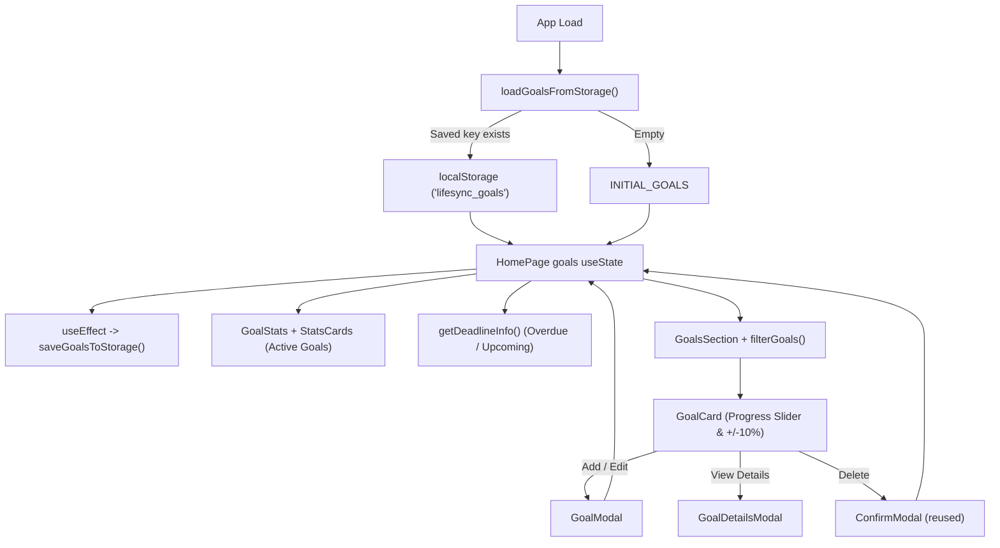
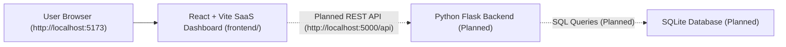

# LifeSync – Personal Life Management Dashboard Documentation

## Overview
**LifeSync** is a full-stack personal productivity dashboard designed to help users manage daily tasks, personal goals, habits, and activities.

This document reflects the **Frontend Dashboard + Task Manager + Phase 5 Goal Tracker** built with **React.js (JavaScript)**, **Vite**, and **`lucide-react`**, using browser `localStorage` for task and goal persistence. The **Python Flask** backend and **SQLite** database will be added and documented in a future phase.

---

## Recent Changes (Phase 5: Goal Tracker)

### 1. Project File Structure
```text
LifeSync/
├── frontend/
│   ├── index.html                        # HTML shell with LifeSync page title
│   ├── package.json                      # React, Vite, Lucide icons, and npm scripts
│   ├── vite.config.js                    # Vite + React plugin configuration
│   └── src/
│       ├── data/
│       │   └── sampleData.js             # Initial tasks, habits, goals (category/dates/status), activities
│       ├── utils/
│       │   ├── taskUtils.js              # Task localStorage, search, status/priority filter, date format
│       │   └── goalUtils.js              # Goal localStorage, status derivation, deadlines, summary, filters
│       ├── components/
│       │   ├── Sidebar.jsx               # Left navigation sidebar + mobile drawer
│       │   ├── DashboardHeader.jsx       # Good Morning greeting, current date, profile icon
│       │   ├── StatsCards.jsx            # 4 dynamic summary KPI cards
│       │   ├── TodayTasks.jsx            # Task Manager toolbar, list, Add/Edit/Delete modal triggers
│       │   ├── TaskItem.jsx              # Individual task card
│       │   ├── TaskModal.jsx             # Modal form for adding/editing tasks
│       │   ├── ConfirmModal.jsx          # Reusable delete confirmation modal (tasks & goals)
│       │   ├── GoalsSection.jsx          # Goal Tracker dashboard, deadline alerts, filters, CRUD modals
│       │   ├── GoalStats.jsx             # Goal Dashboard (Total, Completed, In Progress, Not Started)
│       │   ├── GoalCard.jsx              # Goal card with badges, progress bar, slider, action buttons
│       │   ├── GoalModal.jsx             # Modal form for adding/editing goals
│       │   ├── GoalDetailsModal.jsx      # Detailed view of goal description, dates, progress, status
│       │   ├── HabitTracker.jsx          # Interactive daily habit checkboxes
│       │   ├── RecentActivities.jsx      # Live timeline of tasks, goals, and habits
│       │   └── SettingsPanel.jsx         # Workspace info for the Settings navigation view
│       ├── pages/
│       │   └── HomePage.jsx              # Central useState + useEffect store for tasks, habits, goals, activities
│       ├── services/
│       │   └── api.js                    # Placeholder API_BASE_URL for future Flask API
│       ├── styles/
│       │   ├── global.css                # Core SaaS light-theme layout, tasks, modals, responsive styles
│       │   └── goals.css                 # Dedicated Goal Tracker cards, badges, sliders, details modal styles
│       ├── App.jsx                       # Root layout combining Sidebar, Header, and HomePage
│       └── main.jsx                      # Mounts <App /> and loads global.css + goals.css
└── personname.md                         # System documentation
```

---

## Logic Descriptions

1. **Goal Persistence (`src/utils/goalUtils.js` & `src/pages/HomePage.jsx`)**:
   - `HomePage.jsx` initializes `goals` via `useState(() => loadGoalsFromStorage(INITIAL_GOALS))` from `localStorage` key `'lifesync_goals'`.
   - `useEffect(() => { saveGoalsToStorage(goals) }, [goals])` saves all Add, Edit, Progress Update, and Delete actions automatically.
2. **Automatic Status Derivation (`getGoalStatus` & `normalizeGoal`)**:
   - `progress === 0` → `'Not Started'`
   - `0 < progress < 100` → `'In Progress'`
   - `progress === 100` → `'Completed'`
   - Any progress update (via `-10%` / `+10%` buttons, range slider, or `GoalModal`) clamps progress to `0–100` and recalculates `status` automatically.
3. **Deadline Management (`getDeadlineInfo`)**:
   - Compares `targetDate` against today's date (`getTodayDateString()`):
     - If `progress === 100` → `'completed'`
     - If `daysLeft < 0` → `'overdue'` (`Overdue by X day(s)`) with red badge and card highlight
     - If `0 <= daysLeft <= 7` → `'upcoming'` (`Due today` / `Due in X day(s)`) with amber badge
4. **Goal Dashboard Metrics & Filtering (`GoalStats.jsx` & `filterGoals`)**:
   - `getGoalSummary(goals)` computes `total`, `completed`, `inProgress`, and `notStarted` counts.
   - `filterGoals(goals, { searchQuery, categoryFilter, statusFilter })` filters by title, category (`Study`, `Career`, `Health`, `Personal`), and derived status.
5. **Reusable Confirmation (`ConfirmModal.jsx`)**:
   - Reused by both `TodayTasks.jsx` and `GoalsSection.jsx` to confirm deletions before modifying state.

---

## Architecture & Flow Diagrams

### Goal Tracker CRUD, Deadlines & Persistence Flow


### Planned Full-Stack Architecture


---

## Client-Side Schemas & Planned API Contract

### Goal Object Schema (`localStorage` key: `lifesync_goals`)
| Field | Type | Required | Description |
| :--- | :--- | :--- | :--- |
| `id` | `number` | Yes | Unique goal identifier (`Date.now()`) |
| `title` | `string` | Yes | Goal title |
| `description` | `string` | No | Detailed goal description |
| `category` | `'Study' \| 'Career' \| 'Health' \| 'Personal'` | Yes | Goal category |
| `startDate` | `string` | No | ISO start date (`YYYY-MM-DD`) |
| `targetDate` | `string` | No | ISO target completion date (`YYYY-MM-DD`) |
| `progress` | `number` | Yes | Integer percentage (`0` to `100`) |
| `status` | `'Not Started' \| 'In Progress' \| 'Completed'` | Yes | Derived automatically from `progress` |

- **Task Object Schema (`localStorage` key: `lifesync_tasks`)**: `id`, `title`, `description`, `priority`, `dueDate`, `category`, `completed`.
- **Planned Backend API**: `http://localhost:5000/api` (placeholder in `frontend/src/services/api.js`); Python Flask + SQLite persistence will be implemented in a later phase.
