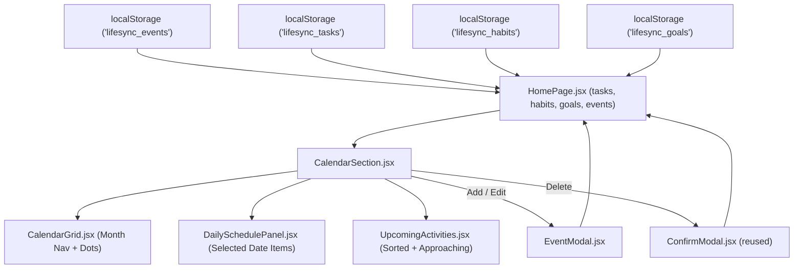
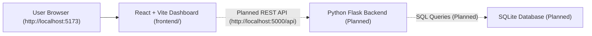

# LifeSync – Personal Life Management Dashboard Documentation

## Overview
**LifeSync** is a full-stack personal productivity dashboard designed to help users manage daily tasks, personal goals, habits, **calendar & scheduling**, activities, and progress reports.

This document reflects the complete **Frontend Application** built with **React.js (JavaScript)**, **Vite**, **`lucide-react`**, and **`recharts`**, using browser `localStorage` for persistence. The **Python Flask** backend and **SQLite** database will be added and documented in a future phase.

---

## Recent Changes (Calendar & Scheduling Module)

### 1. Created & Updated Files
- `src/utils/calendarUtils.js`: Monthly grid builder (`buildMonthCalendarDays`), strict `YYYY-MM-DD` & `HH:MM` validation/formatting, unified daily activity merger (`getActivitiesForDate`), indicator dot map (`getDateIndicatorMap`), chronological upcoming sorter with 3-day approaching deadline detection (`getUpcomingActivities`), and `localStorage` helpers (`'lifesync_events'`).
- `src/components/CalendarSection.jsx`: Coordinates month navigation, selected date state, Event CRUD modals (`EventModal` + reused `ConfirmModal`), daily schedule panel, and upcoming activities.
- `src/components/CalendarGrid.jsx`: Interactive monthly calendar grid with Previous/Next/Today buttons, today & selected date highlights, and color-coded indicator dots for Events, Tasks, Habits, and Goals.
- `src/components/DailySchedulePanel.jsx`: Displays all scheduled items for the clicked date (title, time, category, priority, status, empty state) with Edit/Delete actions for Events.
- `src/components/UpcomingActivities.jsx`: Chronologically sorted list of upcoming events, pending tasks, and active goal deadlines, highlighting items within 3 days.
- `src/components/EventModal.jsx`: Modal form for adding/editing events (`title`, `description`, `date`, `startTime`, `endTime`, `category`, `priority`).
- `src/styles/calendar.css`: Responsive calendar grid, dot legend, schedule items, and upcoming deadline styles matching Warm Paper & Cobalt Ink.
- `src/components/Sidebar.jsx`, `src/components/DashboardHeader.jsx`, `src/components/RecentActivities.jsx`, `src/pages/HomePage.jsx`, `src/main.jsx`, `src/data/sampleData.js`: Added the **Calendar** section, `'lifesync_events'` persistence, and Event activity logging without duplicating tasks, habits, or goals.

---

## Logic Descriptions

1. **Non-Duplicating Cross-Module Integration (`calendarUtils.js`)**:
   - **Tasks**: `getActivitiesForDate()` and `getDateIndicatorMap()` read `task.dueDate` directly from `HomePage`'s `tasks` state (`'lifesync_tasks'`). Completing or editing a task in Task Manager updates the Calendar immediately.
   - **Habits**: Reads `habit.completedDates` and daily habit state directly from `habits` (`'lifesync_habits'`) for today/current week check-in status without duplicating records.
   - **Goals**: Reads `goal.targetDate`, `goal.progress`, and `getGoalStatus()` directly from `goals` (`'lifesync_goals'`) to display goal deadlines on the calendar.
2. **Event CRUD & Validation (`EventModal.jsx`, `HomePage.jsx`)**:
   - Validates required title, valid `YYYY-MM-DD` date (`isValidDateKey`), and `endTime >= startTime`.
   - Saves events to `'lifesync_events'` via `useEffect`, logs event creation/update/deletion into `activities`, and reuses `ConfirmModal` before deleting.
3. **Upcoming Activities Sorting (`getUpcomingActivities`)**:
   - Combines future/today Events, pending Tasks with due dates, and incomplete Goal deadlines, sorting ascending by `date` then `startTime`, and flagging items where `0 <= daysUntil <= 3` as approaching deadlines.

---

## Architecture & Flow Diagram

### Calendar & Cross-Module Scheduling Flow

### Planned Full-Stack Architecture

---

## Client-Side Event Schema (`localStorage` key: `lifesync_events`)

| Field | Type | Required | Description |
| :--- | :--- | :--- | :--- |
| `id` | `number` | Yes | Unique event identifier |
| `title` | `string` | Yes | Event title |
| `description` | `string` | No | Optional notes/agenda |
| `date` | `string` | Yes | Valid ISO date (`YYYY-MM-DD`) |
| `startTime` | `string` | No | 24-hour time (`HH:MM`) |
| `endTime` | `string` | No | 24-hour time (`HH:MM`) |
| `category` | `'Personal' \| 'Work' \| 'Education' \| 'Meeting' \| 'Other'` | Yes | Event category |
| `priority` | `'High' \| 'Medium' \| 'Low'` | Yes | Event priority |

- **Tasks (`lifesync_tasks`)**, **Habits (`lifesync_habits`)**, **Goals (`lifesync_goals`)**, and **Activities (`lifesync_activities`)** remain live-synced across Calendar, Dashboard, and Reports.
- **Planned Backend API**: `http://localhost:5000/api` (placeholder in `frontend/src/services/api.js`); Python Flask + SQLite persistence will be added in a future phase.
