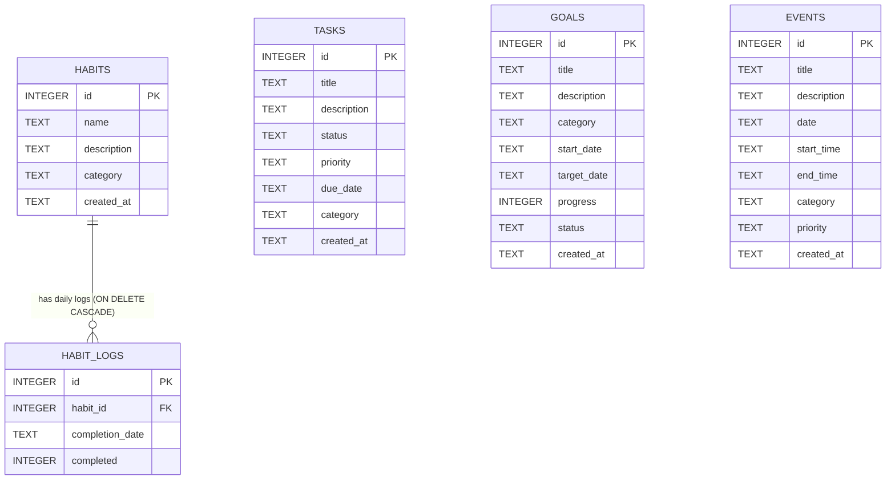
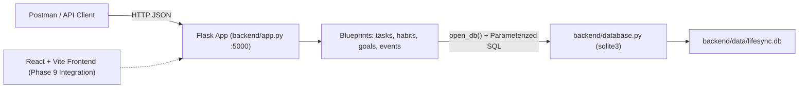

# LifeSync – Personal Life Management Dashboard Documentation

## Overview
**LifeSync** is a full-stack personal productivity dashboard designed to help users manage daily tasks, personal goals, habits, calendar scheduling, activities, and progress reports.

This document reflects:
- **Frontend (`frontend/`)**: React.js (JavaScript) + Vite + `lucide-react` + `recharts` using browser `localStorage` (unchanged in Phase 8; integration with Flask follows in Phase 9).
- **Backend (`backend/`)**: **Phase 8 Python Flask + SQLite REST API** storing persistent data in `backend/data/lifesync.db`.

---

## Recent Changes (Phase 8: SQLite Database Integration)

### 1. Backend File Structure
```text
LifeSync/
├── frontend/                  # React + Vite frontend (unchanged in Phase 8)
├── backend/
│   ├── venv/                  # Python 3.13 virtual environment (Flask 3.1.3, flask-cors 6.0.5)
│   ├── requirements.txt       # Pinned Python dependencies
│   ├── .gitignore             # Excludes venv/, __pycache__/, and *.db
│   ├── database.py            # sqlite3 connection helper (PRAGMA foreign_keys = ON) & init_db()
│   ├── app.py                 # Calls init_db() on startup, enables CORS, verifies DB in /api/health
│   ├── data/
│   │   └── lifesync.db        # SQLite database file (auto-created on startup)
│   └── routes/
│       ├── __init__.py
│       ├── validation.py      # Shared open_db(), JSON parsing, date/time validation, errors
│       ├── tasks.py           # /api/tasks backed by SQLite tasks table
│       ├── habits.py          # /api/habits + /complete, /history, /status backed by habits & habit_logs
│       ├── goals.py           # /api/goals backed by SQLite goals table
│       └── events.py          # /api/events backed by SQLite events table
└── personname.md              # System documentation
```

---

## Database & Safety Logic

1. **Connection & Foreign Keys (`backend/database.py`)**:
   - `get_db_connection()` opens `backend/data/lifesync.db` (or `app.config["DATABASE_PATH"]`), sets `row_factory = sqlite3.Row`, and executes `PRAGMA foreign_keys = ON;`.
   - Every route closes its SQLite connection in a `try ... finally: conn.close()` block.
   - All SQL queries use `?` parameter placeholders (zero string concatenation).
2. **Automatic Non-Destructive Initialization (`init_db()`)**:
   - Invoked automatically inside `create_app()` using `CREATE TABLE IF NOT EXISTS ...` so existing database data is preserved across Flask restarts.
3. **Habit Tracking & Duplicate Guard (`backend/routes/habits.py`)**:
   - `habit_logs` references `habits(id)` via `FOREIGN KEY (habit_id) REFERENCES habits (id) ON DELETE CASCADE` and enforces `UNIQUE (habit_id, completion_date)`.
   - `POST /api/habits/<id>/complete` inserts into `habit_logs` and catches `sqlite3.IntegrityError` to return `409 Conflict` when checking in twice on the same date.
   - `GET /api/habits/<id>/history` returns all completion logs ordered newest first; `GET /api/habits/<id>/status?date=YYYY-MM-DD` checks daily completion status.

---

## Architecture & ER Diagrams

### SQLite Entity-Relationship Diagram


### Phase 8 Backend Request Architecture


---

## REST API Contracts (`http://localhost:5000`)

- **Health**: `GET /api/health` → `200 OK` (`{"status": "ok", "storage": "sqlite", ...}`)
- **Tasks**: `GET /api/tasks`, `POST /api/tasks` (`201`), `PUT /api/tasks/<id>`, `DELETE /api/tasks/<id>`
- **Habits**:
  - `GET /api/habits`, `POST /api/habits` (`201`), `PUT /api/habits/<id>`, `DELETE /api/habits/<id>`
  - `POST /api/habits/<id>/complete` → Body `{"date": "YYYY-MM-DD"}` (optional, defaults to today) → `201 Created` or `409 Conflict` on duplicate date
  - `GET /api/habits/<id>/history` → `200 OK` (`{"habitId", "habitName", "history", "totalCompletions", "streakDays"}`)
  - `GET /api/habits/<id>/status?date=YYYY-MM-DD` → `200 OK` (`{"habitId", "habitName", "date", "completed", "streakDays"}`)
- **Goals**: `GET /api/goals`, `POST /api/goals` (`201`), `PUT /api/goals/<id>`, `DELETE /api/goals/<id>`
- **Events**: `GET /api/events`, `POST /api/events` (`201`), `PUT /api/events/<id>`, `DELETE /api/events/<id>`
