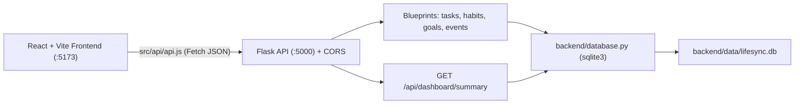
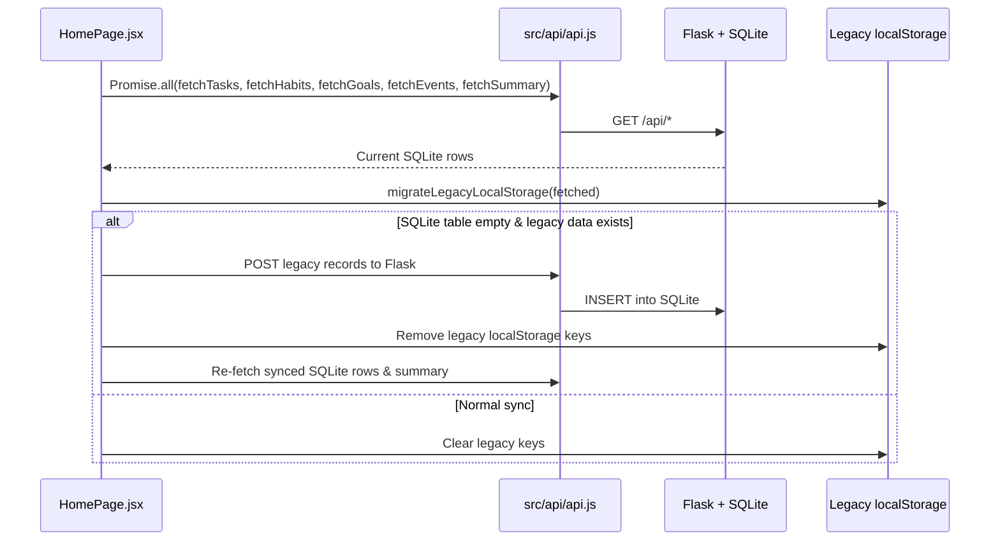

# LifeSync – Personal Life Management Dashboard Documentation

## Overview
**LifeSync** is a full-stack personal productivity dashboard designed to help users manage daily tasks, personal goals, habits, calendar scheduling, activities, and progress reports.

This document reflects **Phase 9: React + Flask + SQLite Integration**, where the **React.js + Vite** frontend communicates directly with the **Python Flask** REST API backed by **SQLite** (`backend/data/lifesync.db`).

---

## Recent Changes (Phase 9: React + Flask Integration)

### 1. Frontend & Backend Changes
- `frontend/src/api/api.js`: Centralized Fetch API client targeting `http://127.0.0.1:5000` with `ApiError`, `apiGet`, `apiPost`, `apiPut`, `apiDelete`, and resource helpers for Health, Dashboard Summary, Tasks, Habits (`/complete`, `/history`, `/status`), Goals, and Calendar Events.
- `frontend/src/services/api.js`: Re-exports `API_BASE_URL` from `src/api/api.js`.
- `frontend/src/utils/migrationUtils.js`: Performs safe one-time migration of legacy `localStorage` data (`lifesync_tasks`, `lifesync_habits`, `lifesync_goals`, `lifesync_events`) into SQLite when backend tables are empty, then removes those legacy `localStorage` keys.
- `frontend/src/pages/HomePage.jsx`: Loads Tasks, Habits, Goals, Events, and Dashboard Summary from Flask on mount, runs async CRUD handlers against Flask APIs, refreshes `/api/dashboard/summary` after mutations, and displays loading, error (with Retry), and success feedback banners.
- `frontend/src/components/StatsCards.jsx`: Displays all 8 live SQLite-backed summary metrics (`Total tasks`, `Completed tasks`, `Pending tasks`, `Upcoming events`, `Total habits`, `Habits today`, `Total goals`, `Completed goals`).
- `frontend/src/components/HabitHistoryModal.jsx`, `HabitCard.jsx`, `HabitTracker.jsx`: Added live `GET /api/habits/<id>/history` modal inspection.
- `frontend/src/components/Sidebar.jsx`, `SettingsPanel.jsx`, `global.css`, `habits.css`: Updated workspace labels and added feedback banner + history modal styles.
- `backend/app.py`: Added `GET /api/dashboard/summary` querying live counts across `tasks`, `habits`, `habit_logs`, `goals`, and `events`.

---

## Architecture & Integration Flow Diagrams

### Full-Stack Phase 9 Architecture

### Initial Load & Legacy Migration Sequence

---

## REST API Contracts (`http://127.0.0.1:5000`)

- **Health**: `GET /api/health` → `{"status": "ok", "storage": "sqlite", ...}`
- **Dashboard Summary**: `GET /api/dashboard/summary` → `{"totalTasks", "completedTasks", "pendingTasks", "totalHabits", "completedHabitsToday", "totalGoals", "completedGoals", "upcomingEvents"}`
- **Tasks**: `GET /api/tasks`, `POST /api/tasks`, `PUT /api/tasks/<id>`, `DELETE /api/tasks/<id>`
- **Habits**: `GET /api/habits`, `POST /api/habits`, `PUT /api/habits/<id>`, `DELETE /api/habits/<id>`, `POST /api/habits/<id>/complete`, `GET /api/habits/<id>/history`, `GET /api/habits/<id>/status`
- **Goals**: `GET /api/goals`, `POST /api/goals`, `PUT /api/goals/<id>`, `DELETE /api/goals/<id>`
- **Events**: `GET /api/events`, `POST /api/events`, `PUT /api/events/<id>`, `DELETE /api/events/<id>`
