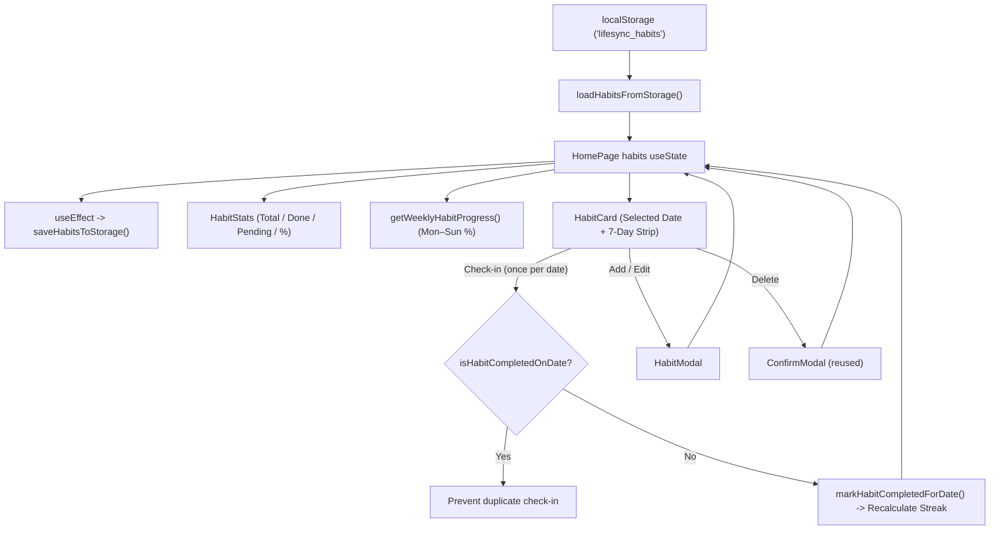
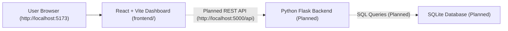

# LifeSync – Personal Life Management Dashboard Documentation

## Overview
**LifeSync** is a full-stack personal productivity dashboard designed to help users manage daily tasks, personal goals, habits, activities, and progress reports.

This document reflects the complete **Frontend Application** (Dashboard, Task Manager, **Phase 4 Habit Tracker**, Goal Tracker, Activities, and Progress Reports) built with **React.js (JavaScript)**, **Vite**, **`lucide-react`**, and **`recharts`**, using browser `localStorage` for persistence. The **Python Flask** backend and **SQLite** database will be added and documented in a future phase.

---

## Recent Changes (Phase 4: Habit Tracker Functionality)

### 1. Project File Structure
```text
LifeSync/
├── frontend/
│   ├── index.html                        # HTML shell loading DM Sans & JetBrains Mono
│   ├── package.json                      # React, Vite, Lucide icons, Recharts, and npm scripts
│   ├── vite.config.js                    # Vite + React plugin configuration
│   └── src/
│       ├── data/
│       │   └── sampleData.js             # Starter tasks, habits (description/category/weeklyLog), goals, activities
│       ├── utils/
│       │   ├── taskUtils.js              # Task localStorage, search, filters, date format (untouched)
│       │   ├── goalUtils.js              # Goal localStorage, status derivation, deadlines, filters
│       │   ├── habitUtils.js             # Habit CRUD, date-wise check-in guard, streak math, weekly progress
│       │   ├── activityUtils.js          # Activity recording, newest-first sorting, filters, localStorage
│       │   └── reportUtils.js            # Dynamic Task/Habit/Goal stats & Recharts series builders
│       ├── components/
│       │   ├── Sidebar.jsx               # Navigation sidebar
│       │   ├── DashboardHeader.jsx       # Active section title, morning context, date, profile
│       │   ├── StatsCards.jsx            # 4 dynamic overview KPI cards
│       │   ├── TodayTasks.jsx            # Task Manager (untouched)
│       │   ├── TaskItem.jsx              # Task card (untouched)
│       │   ├── TaskModal.jsx             # Add/Edit task modal (untouched)
│       │   ├── ConfirmModal.jsx          # Reusable delete confirmation modal (tasks, habits, goals)
│       │   ├── HabitTracker.jsx          # Habit Dashboard, Weekly Progress bar, date picker, CRUD modals
│       │   ├── HabitStats.jsx            # Total, Completed today, Pending, and Overall completion %
│       │   ├── HabitCard.jsx             # Habit card with streak pill, Mon–Sun dots, duplicate-safe check-in
│       │   ├── HabitModal.jsx            # Modal form for adding/editing habits (name, description, category)
│       │   ├── GoalsSection.jsx          # Goal Tracker
│       │   ├── GoalStats.jsx             # Goal summary cards
│       │   ├── GoalCard.jsx              # Goal card
│       │   ├── GoalModal.jsx             # Add/Edit goal modal
│       │   ├── GoalDetailsModal.jsx      # Goal details modal
│       │   ├── RecentActivities.jsx      # Filterable activity timeline, newest first
│       │   ├── ReportsSection.jsx        # Task/Habit/Goal stats, streaks, and 4 Recharts charts
│       │   └── SettingsPanel.jsx         # Workspace info
│       ├── pages/
│       │   └── HomePage.jsx              # Central useState + useEffect store for all modules
│       ├── services/
│       │   └── api.js                    # Placeholder API_BASE_URL for future Flask API
│       ├── styles/
│       │   ├── global.css                # Warm Paper & Cobalt Ink tokens, shell, tasks, modals
│       │   ├── habits.css                # Habit Dashboard, weekly progress, cards, and 7-day strip styles
│       │   ├── goals.css                 # Goal Tracker styles
│       │   └── reports.css               # Activities & Progress Reports styles
│       ├── App.jsx                       # Root layout
│       └── main.jsx                      # Mounts <App /> and loads all stylesheets
└── personname.md                         # System documentation
```

---

## Logic Descriptions (Phase 4 Habit Tracker)

1. **Habit CRUD & `localStorage` Persistence (`src/utils/habitUtils.js`, `src/pages/HomePage.jsx`)**:
   - Habits load from `localStorage` key `'lifesync_habits'` via `loadHabitsFromStorage(INITIAL_HABITS)` and save automatically via `useEffect`.
   - `handleAddHabit`, `handleEditHabit`, and `handleDeleteHabit` create, update, or remove habits (using `HabitModal.jsx` and `ConfirmModal.jsx`) and record corresponding entries in `activities`.
2. **Date-Wise Check-In & Duplicate Prevention (`markHabitCompletedForDate`)**:
   - `HabitTracker.jsx` provides a `Tracking date` `<input type="date">` defaulting to today (`getTodayDateString()`).
   - `markHabitCompletedForDate(habit, dateKey)` checks `isHabitCompletedOnDate(habit, dateKey)` first. If already completed for that date, it returns `{ habit, alreadyCompleted: true }` without adding a duplicate check-in, incrementing the streak, or recording duplicate activity logs.
   - In the UI (`HabitCard.jsx`), the check-in button becomes disabled once checked in for the selected date.
3. **Consecutive Streak Calculation (`calculateConsecutiveStreak`)**:
   - Counts consecutive `YYYY-MM-DD` entries in `completedDates` backwards from today (or yesterday if today is not yet checked in, preserving active streaks until today's check-in).
4. **Habit Dashboard & Current Week Progress (`HabitStats.jsx`, `getHabitDashboardSummary`, `getWeeklyHabitProgress`)**:
   - `HabitStats.jsx` shows **Total habits**, **Completed today** (or on selected date), **Pending habits**, and **Completion rate (%)**.
   - `getCurrentWeekDates()` computes the Monday–Sunday dates of the current week, powering both the per-habit 7-day dot strip in `HabitCard.jsx` and the **Current week progress** bar + percentage in `HabitTracker.jsx`.

---

## Architecture & Flow Diagrams

### Phase 4 Habit Tracker Flow


### Planned Full-Stack Architecture


---

## Client-Side Schemas & Planned API Contract

### Habit Object Schema (`localStorage` key: `lifesync_habits`)
| Field | Type | Required | Description |
| :--- | :--- | :--- | :--- |
| `id` | `number` | Yes | Unique habit identifier |
| `name` | `string` | Yes | Habit name |
| `description` | `string` | No | Optional habit description |
| `category` | `'Health' \| 'Learning' \| 'Mindfulness' \| 'Productivity' \| 'Personal'` | Yes | Habit category |
| `completedDates` | `string[]` | Yes | Unique sorted `YYYY-MM-DD` check-in dates |
| `weeklyLog` | `Record<string, boolean>` | Yes | Map of `YYYY-MM-DD` completion flags for Reports |
| `completed` | `boolean` | Yes | Completion status for today |
| `streakDays` | `number` | Yes | Consecutive completed days |
| `streak` | `string` | Yes | Formatted streak label (`"5 days"`) |

- **Task Schema (`lifesync_tasks`)**, **Goal Schema (`lifesync_goals`)**, and **Activity Schema (`lifesync_activities`)** remain unchanged and live-synced with `ReportsSection.jsx`.
- **Planned Backend API**: `http://localhost:5000/api` (placeholder in `frontend/src/services/api.js`); Python Flask + SQLite persistence will be added in a future phase.
