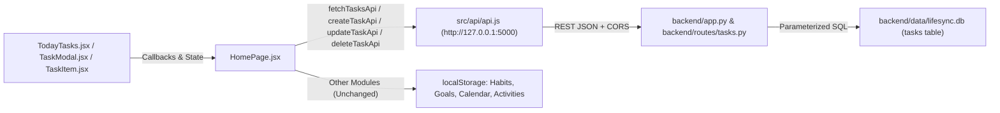
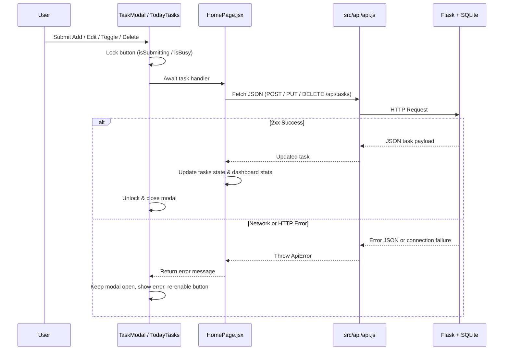

# LifeSync – Personal Life Management Dashboard Documentation

## Overview
**LifeSync** is a full-stack personal productivity dashboard built with **React.js + Vite** on the frontend and **Python Flask + SQLite** on the backend.

This documentation covers **Task Manager Integration (Flask + SQLite)**, where the **Task Manager** module communicates with Flask REST APIs backed by `backend/data/lifesync.db`, while **Habit Tracker**, **Goal Management**, and **Calendar** continue using browser `localStorage` without modification.

---

## Task Manager Integration Changes

### 1. Frontend Files Updated
- `frontend/src/api/api.js`: Centralized Fetch API helper configured with `API_BASE_URL = 'http://127.0.0.1:5000'`, structured `ApiError` error handling, and task CRUD helpers (`fetchTasksApi`, `createTaskApi`, `updateTaskApi`, `deleteTaskApi`).
- `frontend/src/pages/HomePage.jsx`:
  - Fetches tasks on initial mount from `GET /api/tasks`.
  - Connects `handleAddTask` (`POST /api/tasks`), `handleEditTask` (`PUT /api/tasks/<id>`), `handleToggleTask` (`PUT /api/tasks/<id>`), and `handleDeleteTask` (`DELETE /api/tasks/<id>`).
  - Tracks loading, API error, success feedback, and `pendingTaskIds` to prevent duplicate requests.
  - Calculates live dashboard statistics (`totalTasks`, `completedTasks`, `pendingTasks`) directly from SQLite-backed `tasks` state.
  - Preserves existing `localStorage` data untouched (does not write new task records to `localStorage`, delete legacy keys, or auto-migrate without user choice).
  - Keeps **Habit Tracker**, **Goal Management**, and **Calendar Events** on `localStorage` unchanged.
- `frontend/src/components/TodayTasks.jsx`: Displays loading, API error (with **Retry**), and success banners; awaits async save/delete operations before closing modals; prevents duplicate form/delete submissions; updates subtitle to `Synced with Flask & SQLite`.
- `frontend/src/components/TaskModal.jsx`: Accepts `isSubmitting` and `submitError` props to disable controls during save and preserve form inputs on API errors.
- `frontend/src/components/TaskItem.jsx`: Accepts `isBusy` prop to disable checkbox, edit, and delete buttons while an API call for that task is in progress.
- `frontend/src/components/ConfirmModal.jsx`: Accepts optional `isConfirming` and `error` props to prevent duplicate delete requests.
- `frontend/src/components/StatsCards.jsx`: Displays `Total tasks`, `Completed tasks`, `Pending tasks`, and `Active goals` using live SQLite task counts.
- `frontend/src/utils/taskUtils.js`: Preserves search, status (`All`, `Pending`, `Completed`), and priority (`All`, `High`, `Medium`, `Low`) filtering for database tasks.
- `frontend/src/components/SettingsPanel.jsx` & `frontend/src/styles/global.css`: Updated settings info and disabled/banner styles.

---

## Architecture & Sequence Diagrams

### Task Manager Full-Stack Architecture

### Task CRUD & Duplicate-Submit Protection Flow

---

## Task Manager API Contracts (`http://127.0.0.1:5000`)

- **`GET /api/tasks`** → `200 OK`
  - Response: `{ "tasks": [ { "id", "title", "description", "status", "completed", "priority", "dueDate", "category", "createdAt" } ], "count": number }`
- **`POST /api/tasks`** → `201 Created`
  - Body: `{ "title", "description", "priority", "dueDate", "category" }`
  - Response: `{ "message": "Task created successfully.", "task": { ... } }`
- **`PUT /api/tasks/<id>`** → `200 OK`
  - Body: Partial or full task fields (`title`, `description`, `priority`, `dueDate`, `category`, `completed` or `status`)
  - Response: `{ "message": "Task updated successfully.", "task": { ... } }`
- **`DELETE /api/tasks/<id>`** → `200 OK`
  - Response: `{ "message": "Task deleted successfully.", "deletedId": number }`
